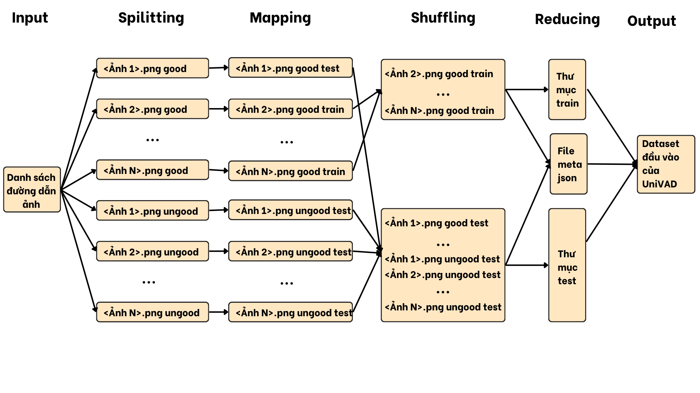

# UniVAD Dataset Preprocessing with Hadoop MapReduce

**A distributed image-data organization and metadata-generation pipeline for a visual anomaly detection research project.**

[](https://www.java.com/)


## Overview

Visual Anomaly Detection (VAD) aims to distinguish normal images from abnormal samples, such as surface defects or incorrect components. A consistent dataset layout is important for evaluating anomaly-detection systems across classes and test scenarios.

This repository contains the **Java/Hadoop MapReduce preprocessing component** used in an academic project studying **UniVAD**, a training-free, few-shot approach to visual anomaly detection. It automates the organization of image paths, assigns normal/abnormal labels, creates train/test splits, and generates structured metadata for downstream processing.

> **Scope:** This repository contains **data preprocessing code only**. It does **not** include UniVAD model inference, CLIP, Grounded SAM, model weights, or a complete training/evaluation pipeline.

## Processing pipeline



1. **Input:** Read a text file containing absolute HDFS image paths, grouped by class and sample condition.
2. **Map:** Parse each path to determine its class (`cls_name`), condition (`good` versus anomalous), split, and anomaly label.
3. **Split:** Assign normal samples to `train` or `test` using a reproducible path-hash rule with a default **20% train / 80% test** threshold; anomalous samples are assigned to `test`.
4. **Reduce:** Copy image files into a class-based output hierarchy and collect metadata fields.
5. **Output:** Emit a JSON-formatted metadata object to the MapReduce job's output and create the arranged image directory structure.

**Important:** The split is a **hash-based threshold**, not an exact per-class random split; actual ratios may vary. The metadata is written as text to the job output (`part-*`), and must be renamed/extracted if a downstream tool specifically requires a file named `meta.json`.

## Example data organization

**Input paths** (illustrative):

```text
/datasets/bottle/good/0001.png
/datasets/bottle/defect/0002.png
```

**Output organization** (the sample class name is illustrative):

```text
/output_private_dataset/Private_Dataset_N2_64CNTT2/
└── bottle/
    ├── train/
    │   └── good/
    └── test/
        ├── good/
        └── defect/
```

**Metadata fields** generated by the mapper/reducer:

```json
{
  "img_path": "test/defect/0002.png",
  "mask_path": "",
  "cls_name": "bottle",
  "specie_name": "defect",
  "anomaly": 1
}
```

The snippet above shows a **single metadata record**, not the entire emitted JSON structure. The reducer groups records under top-level `train` and `test` keys, followed by class names. `mask_path` is empty because segmentation masks are outside the scope of this job.

## Repository structure

```text
univad-hadoop-preprocessing/
├── src/
│   ├── DataMapper.java       # Parse paths, assign split/label, emit records
│   ├── DataReducer.java      # Copy images and assemble metadata
│   └── SplitAndMetaJob.java  # Hadoop job configuration and entry point
├── docs/
│   └── mapreduce-workflow.png
└── README.md
```

## Technologies

**Java**, **Apache Hadoop MapReduce**, **HDFS**, and **JSON** metadata.

## Running the MapReduce job

**Prerequisites:** A configured Hadoop cluster with HDFS access, Java/JDK compatible with the Hadoop distribution, the Hadoop Java classpath, and an input text file listing image paths that are accessible to the job.

1. Clone the repository and inspect the three Java files.
2. **Configure the output root** currently hardcoded as `/output_private_dataset/Private_Dataset_N2_64CNTT2/` in the source code. This path was used for a specific lab dataset and is not portable by default.
3. Compile the Java sources against your Hadoop libraries, package a runnable JAR, and submit the job with **two positional arguments**: `input_list_txt` and `output_dir`.

Example submission (after compiling a JAR):

```bash
hadoop jar your-preprocessing.jar SplitAndMetaJob \
  /datasets/image_paths.txt /jobs/univad-preprocess-output
```

The MapReduce job also supports the optional Hadoop property `train.percent` (default `20`). The first argument is the input list; the second is the Hadoop job-output directory, not the image destination root. The image destination remains **hardcoded in the mapper** unless changed.

**Repository limitations:** No prebuilt JAR, Hadoop environment, datasets, inference model, or standalone build configuration is included. This project has environment-specific paths and has not been verified as a one-command install.

## Project context

The accompanying academic study explored the wider UniVAD architecture, including component segmentation, patch matching, and graph-based component relationships. **Those model components are described in the research report but are not implemented in this repository.** The code here demonstrates how to prepare and organize an image dataset for that workflow.

## What this project demonstrates

- Understanding of **distributed data processing** using Hadoop MapReduce and HDFS.
- Parsing and organizing visual datasets for downstream **computer vision** tasks.
- Generating structured labels and metadata from raw image paths.
- Awareness of reproducibility, class organization, and pipeline limitations.

## Attribution and references

This module was developed as part of a **team academic project**. Credit to team members and original research authors should be preserved; describe personal contribution separately when using the project in a CV.

**Research reference:** [UniVAD: A Training-free Unified Model for Few-shot Visual Anomaly Detection (2024)](https://arxiv.org/abs/2412.03342).
